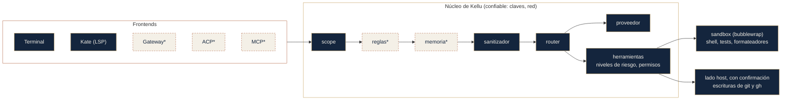

<p align="center">
  <picture>
    <source media="(prefers-color-scheme: dark)" srcset="/assets/branding/svg/kellu-logo-color-dark.svg">
    
  </picture>
</p>
<p align="center">
    <em>Local-first, modular AI assistant & LSP CLI built with Rust</em>
</p>

---

# Kellu

[English](README.md) · [Español](README.es.md)

**Asistente de IA seguro y modular para el editor Kate, que piensa antes de gastar tokens.**

> **Estado: pre-0.1.0.** Se reconstruye en Rust con diseño de seguridad primero. Los hitos M0 a M4 están hechos (workspace, configuración estricta, logs y sesiones privados, `kellu doctor`, `kellu config`, proveedores de modelos y router con paridad respecto del prototipo, la capa de seguridad: bóveda de claves, redacción, deny globs, scope, grants, permisos y auditoría, y el sandbox con bubblewrap y sus tests de escape); desde M5 en adelante sigue siendo diseño, y ninguna herramienta corre aún en el sandbox. `kellu keys` y `kellu providers test` funcionan; el asistente en sí (REPL y LSP) aún no existe. Los prototipos anteriores en Python y Ruby viven en las ramas `original-python` y `kellu-prototype-ruby` y son la referencia de comportamiento del port. Las APIs, comandos y configuración cambiarán. Aún no hay versión publicada. Modelo de seguridad: ver [SECURITY.md](SECURITY.md).

---

## ¿Qué es Kellu?

Kellu lleva asistencia de IA a [Kate](https://kate-editor.org/) sin una pila gráfica pesada. No es solo un chat con un LLM. Un núcleo pequeño y sin interfaz decide **si** hace falta un modelo, redacta lo que sale de tu máquina, enruta cada tarea al proveedor adecuado con respaldo, ejecuta dentro de un sandbox cualquier herramienta que lance procesos, y se comunica con el editor mediante frontends delgados.

## Principios

- **Seguridad primero, fallar cerrado.** Si una protección no está disponible (por ejemplo, no hay backend de sandbox), la capacidad peligrosa se desactiva en lugar de ejecutarse sin protección.
- **Mínimo privilegio.** Las claves viven en el keyring del sistema, separadas en niveles. El modelo nunca ve secretos. Las herramientas corren con el acceso mínimo necesario.
- **No confiable por defecto.** Archivos, páginas web y snippets guardados son datos, nunca instrucciones.
- **Cascada de decisión.** Reglas, luego memoria, y el LLM como última opción. Siempre puedes forzar un modelo.
- **Modular y frugal.** Un conjunto mínimo y auditado de dependencias (Rust puro cuando es posible), funciones opcionales, proveedores, almacenes y frontends reemplazables.
- **Terminal primero.** Validar el núcleo antes de añadir cualquier GUI.
- **Adaptable.** Corre en un portátil modesto con proveedores en la nube, o en una estación con modelos locales.

## Plan de versiones

| Versión | Enfoque | Contenido |
|---|---|---|
| **0.1.0** | Base segura | Núcleo modular, proveedores unificados (compatible con OpenAI; Gemini y Gemma vía Google; OpenRouter, DeepSeek y xAI Grok incluidos), vault de keyring con niveles, redacción y deny globs, permisos por riesgo, **sandbox** (bubblewrap), herramientas (archivos, shell en sandbox, git), REPL en terminal, LSP para Kate (hover y completado), `kellu doctor` |
| **0.2.0** | Agente | Loop de agente con herramientas y confirmaciones, etapa de reglas de la cascada, inyección de contexto, diagnósticos LSP y sugerencias de corrección rápida |
| **0.3.0** | Interoperabilidad | Gateway local compatible con OpenAI, modo agente ACP |
| **0.4.0** | Memoria | Almacén de soluciones aceptadas (SQLite por defecto, PostgreSQL + pgvector opcional), etapa de memoria |
| **0.5.0** | Adaptación | Detección de runtimes locales (Ollama, LM Studio, llama.cpp), perfiles de hardware, servidor y cliente MCP |
| **Después** | | GUI mediante plugins existentes de Kate; backends de sandbox Landlock, macOS y Windows |

0.1.0 **no incluye intencionalmente un loop de agente autónomo**: las herramientas, los permisos y el sandbox se validan por separado antes de que un modelo pueda dispararlos.

## Arquitectura



Los nodos punteados marcados con `*` son posteriores a 0.1.0.

El núcleo no tiene interfaz ni efectos secundarios al importarse. Frontends, proveedores y almacenes son adaptadores reemplazables. Dirección de dependencias: `frontends → core → tools → sandbox → security → common`, con `providers` y `projects` también por debajo de `core` (ver [docs/ARCHITECTURE.md](docs/ARCHITECTURE.md)). Un test lo hace cumplir.

## Seguridad de un vistazo

- **Sandbox.** Las herramientas que lanzan procesos corren en bubblewrap: sin red por defecto, sistema en solo lectura, solo una copia de trabajo del proyecto montada (el proyecto real nunca es escribible), entorno depurado y sin acceso a `~/.ssh`, `~/.gnupg` ni al bus del keyring.
- **Niveles de claves.** Las claves `provider` están disponibles en el flujo normal. Los secretos `infra` y `db` (nube, DNS, bases de datos) no son accesibles para el asistente salvo habilitación explícita con confirmación.
- **Niveles de riesgo.** Cada herramienta es `read`, `write`, `destructive` o `network`. Las acciones destructivas requieren confirmación escrita. Las escrituras de git y GitHub corren en el host, nunca dentro del sandbox.
- **Salida de datos.** Los deny globs (`.env`, claves, certificados) y la redacción de secretos se aplican antes de enviar algo a un proveedor. Se planea un modo solo local por proyecto.
- **La seguridad de memoria no es aislamiento.** Rust evita una clase de errores en Kellu; lo que restringe las herramientas es el sandbox.

Detalles, modelo de amenazas y límites: [SECURITY.md](SECURITY.md).

## Cascada de decisión (diseño, 0.2.0 a 0.4.0)

1. **Reglas.** Manejo determinista que no necesita modelo (detección de stack, estado de git, comandos conocidos).
2. **Memoria.** Busca soluciones aceptadas previamente. Se reutiliza solo si la aceptaste o pasaron los tests, supera un umbral de similitud y no ha caducado. Las respuestas reutilizadas se etiquetan "desde memoria".
3. **LLM.** Enruta por tipo de tarea al mejor proveedor, con respaldo. Fuerza un modelo con `--model` o una opción equivalente.

## Proyectos y scopes

Los proyectos se descubren bajo una raíz configurable y se agrupan en macro-proyecto, repositorio y subproyecto. Cada scope puede definir reglas, proveedores preferidos, límites de recursos y un modo de privacidad (por ejemplo, solo local).

## Agentes y extensiones

Kellu hablará los protocolos abiertos para agentes y herramientas (ACP y MCP, entre 0.3.0 y 0.5.0). Los agentes y servidores MCP, propios o de terceros, se tratan como **extensiones no confiables**: corren como procesos en sandbox con entorno depurado, se habilitan solo mediante una lista de permitidos explícita por servidor, y cada herramienta que exponen necesita un nivel de riesgo declarado. No hay código por agente dentro del núcleo; un único cliente genérico los atiende a todos.

Ideas en evaluación, como repositorios separados y fuera de 0.1.0:

- **kellu-crawler**: crawler web enfocado a proyectos e investigación
- **kellu-ocr**: extracción de texto (OCR) para PDF escaneados antiguos y documentos similares

Los resultados se entregarían a la terminal o como archivos; la entrega dentro de Kate depende de lo que su cliente LSP pueda mostrar.

## Estructura del proyecto

```
kellu/
├── Cargo.toml  Cargo.lock  rust-toolchain.toml  deny.toml
├── LICENSE  README.md  README.es.md  SECURITY.md  CHANGELOG.md  HANDOFF.md
├── crates/
│   ├── kellu-common/      # errores, rutas XDG, archivos privados, utilidades de texto, reglas de endpoint, marcas UTC
│   ├── kellu-providers/   # tipos, transporte HTTP, clientes compatible OpenAI y Google, registro
│   ├── kellu-core/        # config, log, sesiones, router (sin efectos al iniciar)
│   ├── kellu-security/    # vault, redacción, deny globs, permisos, scope, grants, auditoría
│   ├── kellu-sandbox/     # bubblewrap, política derivada del Grant, staging, límites
│   ├── kellu-projects/    # (M5) descubrimiento, detección de stack, scopes
│   ├── kellu-tools/       # (M5) registro con nivel de riesgo obligatorio; archivos, shell, git
│   └── kellu-frontends/   # (M6) REPL, LSP, tema de terminal (después: gateway, ACP, servidor MCP)
├── kellu/                 # crate binario: CLI, doctor
├── docs/                  # ARCHITECTURE.md, PORTING.md, porting/, notas de diseño
└── packaging/             # entrada de escritorio
```

Los crates se añaden **cuando empieza su hito**, no antes. Hoy existen `kellu-common` (M0), `kellu-core` y `kellu-providers` (M1; clientes, transporte y router desde M2), `kellu-security` (M3) y `kellu-sandbox` (M4). Faltan `kellu-tools` y `kellu-projects` (M5), `kellu-frontends` (M6), y más adelante un crate `kellu-memory` (0.4.0, SQLite y pgvector opcional). La cascada de decisión vive en `kellu-core` (0.2.0 a 0.4.0) y el cliente MCP en `kellu-tools` (0.5.0). Cargo hace cumplir la dirección de dependencias (un ciclo no compila) y un test sobre `cargo metadata`. Ver [docs/ARCHITECTURE.md](docs/ARCHITECTURE.md) y [docs/PORTING.md](docs/PORTING.md).

## Inicio rápido

> Los comandos describen la **interfaz objetivo** y pueden cambiar antes de 0.1.0. Hoy funcionan `kellu --version`, `kellu doctor`, `kellu config path|check|show`, `kellu keys list|set|rm|cleanup-legacy` y `kellu providers test`; `tools` y `lsp` avisan que aún no están implementados.

Requisitos (Linux primero): una toolchain de Rust para compilar desde el código fuente, `libsecret-tools` (`secret-tool`) y `bubblewrap`. En Debian o Ubuntu:

```
sudo apt install libsecret-tools bubblewrap
```

Algunas distribuciones restringen los user namespaces sin privilegios (por ejemplo Ubuntu 24.04); `kellu doctor` te dice si el sandbox puede ejecutarse.

```
# Una vez publicado
cargo install --locked kellu

# Desarrollo
git clone https://github.com/<tu-usuario>/kellu.git
cd kellu
cargo build --release       # binario en target/release/kellu
cargo test --workspace

kellu doctor                 # revisa configuración, herramientas del keyring y bubblewrap
kellu config show            # proveedores, rutas y nombres de claves (nunca valores)
kellu keys set openrouter    # el secreto se lee por stdin (oculto en terminal), se guarda en tu keyring, sin mostrarse
kellu keys list              # nombres y niveles, nunca valores
kellu providers test         # una petición mínima por proveedor: endpoint, modelo y clave
kellu                        # asistente en terminal
```

Si tienes entradas con el esquema anterior del keyring (atributo `kai`), `kellu keys cleanup-legacy` las lista (solo nombres) y `--apply` borra únicamente las que ya existen con el esquema nuevo. Copiar las antiguas no está automatizado.

### Úsalo dentro de Kate (LSP)

En Kate: *Preferencias → Configurar Kate → Cliente LSP → Configuración de servidores de usuario*. Ejemplo:

```json
{
  "servers": {
    "python": {
      "command": ["kellu", "lsp"],
      "highlightingModeRegex": "^Python$"
    }
  }
}
```

En 0.1.0 el servidor LSP de Kellu ofrece **hover** y **completado**; los diagnósticos y las sugerencias de corrección rápida llegan con el trabajo del agente en 0.2.0. El chat, la vista previa de diffs y el texto fantasma necesitan otros frontends (ver [docs/design/lsp-capabilities.md](docs/design/lsp-capabilities.md)). Revisa la documentación del cliente LSP de Kate para el formato exacto en tu versión.

## Configuración

| Ruta | Propósito |
|---|---|
| `~/.config/kellu/` | Proveedores, enrutamiento, scopes, política de sandbox |
| `~/.local/state/kellu/` | Registros de sesión, historial (redactados, modo 0700) |
| `~/.cache/kellu/` | Cachés |

La configuración es un único archivo TOML, `~/.config/kellu/config.toml`, combinado sobre los defaults empaquetados. Nunca contiene secretos (usa el keyring), los endpoints deben usar HTTPS (HTTP solo para localhost), las claves desconocidas son errores, y el archivo debe pertenecerte y no ser escribible por grupo ni otros. Revísala con `kellu config path`, `kellu config check` y `kellu config show`. Los mensajes de error nombran la clave afectada y nunca imprimen su valor.

```toml
[routing.code]
primary = "deepseek"
backup = ["openrouter"]

[routing.general]
primary = "google"
backup = ["deepseek", "openrouter"]
```

## Perfiles de hardware (objetivo de diseño)

| Perfil | Objetivo | Qué corre |
|---|---|---|
| `minimal` | cualquier equipo | núcleo + terminal, proveedores en la nube, SQLite |
| `standard` | portátil habitual | además LSP y MCP, modelo local pequeño para completado |
| `full` | RAM o GPU holgadas | además integración con plugins de Kate, modelos locales mayores, PostgreSQL + pgvector |

## Hitos hacia 0.1.0

M0 a M2 se implementaron primero en el prototipo de Python y se portan con paridad de comportamiento (ver [docs/PORTING.md](docs/PORTING.md) y [docs/porting/PARITY.md](docs/porting/PARITY.md)).

- [x] **M0** Repositorio, workspace de Cargo, rutas XDG, CI, tests, licencia, `SECURITY.md`
- [x] **M1** Configuración con defaults empaquetados, errores, logging, sesiones; sin efectos al iniciar
- [x] **M2** Proveedores: cliente compatible con OpenAI (streaming, herramientas), Google, router con timeouts y respaldo
- [x] **M3** `kellu keys` con niveles, `kellu providers test`, entorno depurado, deny globs, redacción v1, permisos por riesgo, scope y grants, auditoría
- [x] **M4** Sandbox: bubblewrap con política derivada del `Grant`, copia de trabajo (staging), límites de recursos, `kellu doctor`, tests de escape contra bubblewrap real
- [ ] **M5** Herramientas con esquemas generados y niveles de riesgo: archivos, shell en sandbox, git de solo lectura; escrituras de git y gh en el host con confirmación
- [ ] **M6** REPL en terminal sobre el núcleo; LSP para Kate (hover, completado)
- [ ] **M7** Documentación y etiqueta 0.1.0

## Proyectos relacionados

Kellu es independiente, pero está pensado para interoperar con otros esfuerzos de IA para Kate en lugar de reemplazarlos:

- [KateAI](https://github.com/ObiWindu/KateAI): plugin de Kate con una experiencia de agente completa en GUI.
- [kate-agents](https://github.com/Mte90/kate-agents): plugin de Kate que lleva agentes al estilo Zed al editor.

La interoperabilidad es una meta, no una integración existente. No se implica respaldo de sus autores.

## Sobre el nombre

*Kellu* significa "ayudante" en mapudungun, la lengua del pueblo mapuche. El nombre refleja el propósito del proyecto: un asistente que ayuda, en silencio, dentro de las herramientas que ya usas.

## Contribuciones

El proyecto es joven y la arquitectura aún se mueve, así que abre un issue antes de enviar cambios grandes. Se agradecen especialmente: revisión de seguridad, sanitización, abstracciones de proveedores, integración LSP y esquemas de datos para memoria orientada a desarrollo. **Reporta las vulnerabilidades en privado**, como se describe en [SECURITY.md](SECURITY.md).

## Licencia

MIT. Ver [LICENSE](LICENSE).

## Aviso legal

Kate es un editor de texto desarrollado por la comunidad KDE. Kellu es un proyecto independiente y no está afiliado, patrocinado ni respaldado por KDE. La salida generada por IA puede ser incorrecta: revisa las sugerencias antes de aplicarlas.
