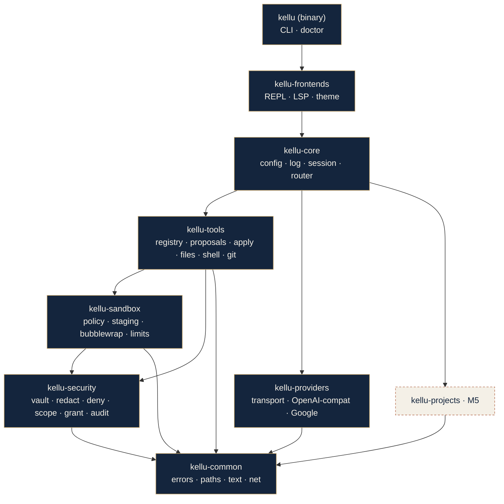
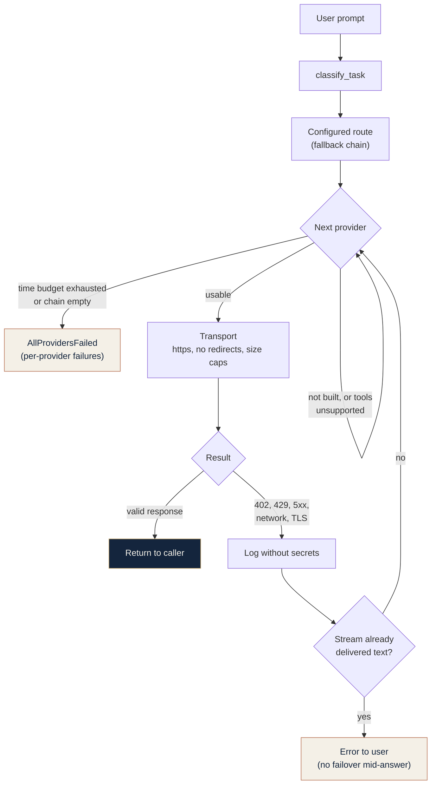

<p align="center">
  <picture>
    <source media="(prefers-color-scheme: dark)" srcset="/assets/branding/svg/kellu-logo-color-dark.svg">
    
  </picture>
</p>
<p align="center">
    <em>Local-first, modular AI assistant & LSP CLI built with Rust</em>
</p>

---

# Architecture

Kellu is a small headless core with replaceable adapters. This document defines the crates and the
dependency rule that tests enforce (`kellu/tests/architecture.rs`).

## Layers (0.1.0)

| Crate | Responsibility | May depend on |
|---|---|---|
| `kellu-common` | Identity constants, errors, XDG paths, private files, text helpers, endpoint rules. Minimal dependencies. | nothing |
| `kellu-security` | Vault, redaction, deny globs, permissions and policy, scope, `Grant`, audit. | `common` |
| `kellu-sandbox` | Sandbox interface, bubblewrap backend, profiles, policy derived from a `Grant`, staging. | `common`, `security` |
| `kellu-providers` | Model provider clients (OpenAI-compatible, Google), HTTP transport, provider-neutral types. They receive their configuration and a key lookup; they never read either themselves. | `common` |
| `kellu-projects` | Project discovery, stack detection. | `common` |
| `kellu-tools` | Tool registry with schemas and mandatory risk levels; proposals and their approved application; file, shell, git and `gh` tools. | `common`, `security`, `sandbox` |
| `kellu-core` | Config, router (task classification, fallback chains, time budget), logging, sessions, `assist` (editor text to bounded, redacted, fenced model requests), (later) cascade and agent loop. | all layers above |
| `kellu-frontends` | Terminal REPL, Kate LSP, (later) gateway, ACP, MCP server. | all layers above and `core` |
| `kellu` (binary) | CLI and `doctor`. | everything |



Solid dark nodes exist today (M0 to M6); dashed nodes are created when their milestone starts.
The binary builds the `Assistant` (in `core`, module `assist`) and hands it to a frontend; the
frontends reach a model only through `Assistant`, so redaction, bounding and fencing cannot be skipped.

One edge goes beyond the earlier Python layering: `sandbox -> security`, because the sandbox
mounts are derived from the `Grant` (see `design/permissions-and-sandbox.md`) and the `Grant`
lives in `kellu-security`. The exact allowed edges are the `ALLOWED` table in
`kellu/tests/architecture.rs`.

Rules:

1. Dependencies only point downward. Cargo rejects cycles; the architecture test rejects upward
   and sideways edges that would still compile, and any crate that is not a declared layer.
2. Inside a crate, paths are absolute from the crate root (`crate::paths`).
3. Constructing or importing something has **no side effects**: no directories, no network, no
   registry writes. Path resolution is pure; only `ensure_*` and `open_*` helpers create files.
4. Every external crate is declared once in the root `Cargo.toml` with a one-line justification,
   used with `default-features = false` where possible, and heavy ones sit behind Cargo features.
5. A crate is created **when its milestone starts**. Empty crates for future features are not
   allowed.
6. Mechanical policy lives in `[workspace.lints]`: `unsafe_code = "forbid"`, and clippy denies
   `unwrap_used`, `expect_used`, `panic`, `todo`, `unimplemented`, `dbg_macro`. Every crate must
   contain `[lints] workspace = true` (checked by the architecture test).

## Layout

```
kellu/
├── Cargo.toml  Cargo.lock  rust-toolchain.toml  clippy.toml  deny.toml  .gitignore  LICENSE
├── README.md  README.es.md  SECURITY.md  CHANGELOG.md
├── .github/workflows/ci.yml
├── crates/
│   ├── kellu-common/        M0  identity, errors, XDG paths, private files; M1 text, net, utc
│   ├── kellu-providers/     M1  provider types; M2 HTTP transport, OpenAI-compatible, Google, registry
│   ├── kellu-core/          M1  config, log, session; M2 router
│   ├── kellu-security/      M3  vault, redaction, deny globs, permissions, scope, Grant, audit
│   ├── kellu-sandbox/       M4  bubblewrap, policy from the Grant, staging, limits, probe; M5 run_host
│   ├── kellu-tools/         M5  registry with mandatory risk level, proposals and apply, files, shell, git, gh
│   ├── kellu-frontends/     M6  REPL, LSP, terminal theme
│       (created when their milestone starts)
│       kellu-projects/      M5  discovery, stack detection
├── kellu/                   M0  binary crate: CLI, doctor; tests/ has end-to-end and architecture
├── docs/                    ARCHITECTURE.md, PORTING.md, porting/, design/
└── packaging/               desktop entry
```

## Status

| Milestone | State | Crates touched |
|---|---|---|
| M0 | done | `kellu-common`, `kellu` |
| M1 | done | `kellu-common`, `kellu-core`, `kellu-providers` (types) |
| M2 | done, behavior parity 137/137 with the Python prototype (`porting/PARITY.md`) | `kellu-providers`, `kellu-core` (router), `kellu-common` (`AllProvidersFailed`) |
| M3 | done | `kellu-security`, `kellu-core` (default redaction), `kellu` (`keys`, `providers test`) |
| M4 | done | `kellu-sandbox`, `kellu-security` (`openat2_available`), `kellu-core` (`[sandbox]` config), `kellu` (`doctor`) |
| M5 | done | `kellu-tools`, `kellu-security` (`Scope::open_dir`, `Grant::without_network`), `kellu-sandbox` (`run_host`), `kellu` (`tools`, `doctor`) |
| M6 | done | `kellu-frontends` (new), `kellu-core` (`assist`, `[lsp]` config), `kellu` (`chat`, `lsp`) |
| M7 | planned | see Layout |

## Providers and router (M2)

`kellu-core::router` picks the provider chain for a task and walks it; `kellu-providers` owns the
wire format and the transport. Providers receive their configuration and a `KeyLookup`; they never
read either themselves.



Transport rules (`kellu-providers`, enforced by tests in `crates/kellu-providers/tests/`):

- Keys travel only in headers, wrapped in `SecretString`; `Debug` is redacted and errors are
  scrubbed before they reach logs or users.
- Redirects are refused. `https` is required; plain `http` is accepted only for localhost and uses
  a separate agent that never reads proxy environment variables.
- Caps: 8 MiB response body, 1 MiB per SSE line, 600 s overall. TLS certificate failures are not
  retried.
- A failure that happens after streamed text reached the user is reported, not retried, so an
  answer is never silently mixed from two models.

## Where future features go

| Feature | Version | Placement |
|---|---|---|
| Decision cascade (rules, memory, LLM) | 0.2.0 to 0.4.0 | `kellu-core`, module `cascade` |
| Agent loop | 0.2.0 | `kellu-core`, module `agent` |
| OpenAI-compatible gateway, ACP agent mode | 0.3.0 | `kellu-frontends`, modules `gateway`, `acp` |
| Memory store (SQLite, optional pgvector) | 0.4.0 | new lower crate `kellu-memory` (depends on `common`) |
| MCP server | 0.5.0 | `kellu-frontends`, module `mcp_server` |
| MCP client (agents and external tools) | 0.5.0 | `kellu-tools`, module `mcp_client` |
| Local runtime detection | 0.5.0 | `kellu-providers`, module `local` |
| Scope and grants | M3 (done; consumed from M4) | `kellu-security`, modules `scope`, `grant` |
| Append-only audit log | M3 (done; consumed from M5) | `kellu-security`, module `audit` |
| Sandbox mounts derived from a grant, staging copy | M4 (done; consumed from M5) | `kellu-sandbox`, modules `policy`, `staging`, `bwrap` |
| Proposal contract and host-side apply | M5 (done) | `kellu-tools`, modules `proposal`, `apply` |
| Tool registry, risk enforcement | M5 (done) | `kellu-tools`, modules `spec`, `registry` |
| Kate LSP server (hover, completion; later diagnostics, code actions) | M6 (done), 0.2.0 | `kellu-frontends`, module `lsp` |

Protocol adapters (ACP, MCP, gateway) are **frontends** or **tools**, never top-level crates.
Adding `kellu-memory` or any other crate means adding its row to `ALLOWED` in the same change.

## Extensions (agents and MCP servers)

Agents such as a crawler or an OCR service, and any MCP server, are **untrusted extensions**.
They are reached through one generic client, run as sandboxed processes with a scrubbed
environment, are enabled by an explicit per-server allowlist, and every tool they expose needs
a declared risk level. The core contains no per-agent code.

## Trust boundary

The core is trusted: it holds keys and network access and enforces policy. Process-spawning
tools and extensions run in the sandbox and are untrusted. Model output, repository content and
web content are untrusted data. Memory safety in Rust is not isolation: the sandbox is. See
[SECURITY.md](../SECURITY.md) and the design notes in [docs/design/](design/).

## Adding a module

1. Pick the lowest crate that can host it.
2. Add tests first, including negative tests for anything security-relevant.
3. Run `cargo fmt --check`, `cargo clippy --workspace --all-targets -- -D warnings` and
   `cargo test --workspace --locked`.
