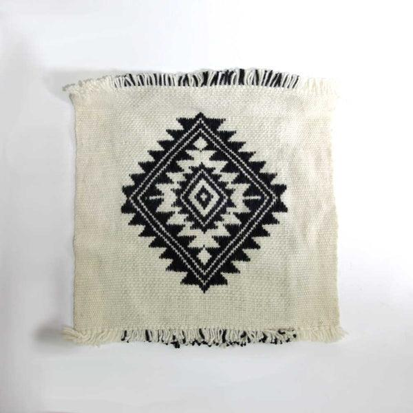
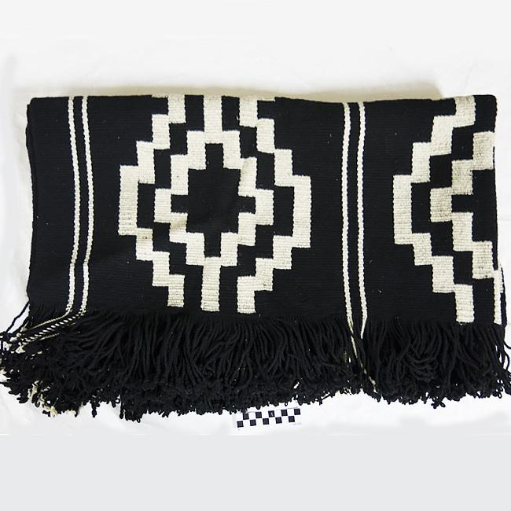
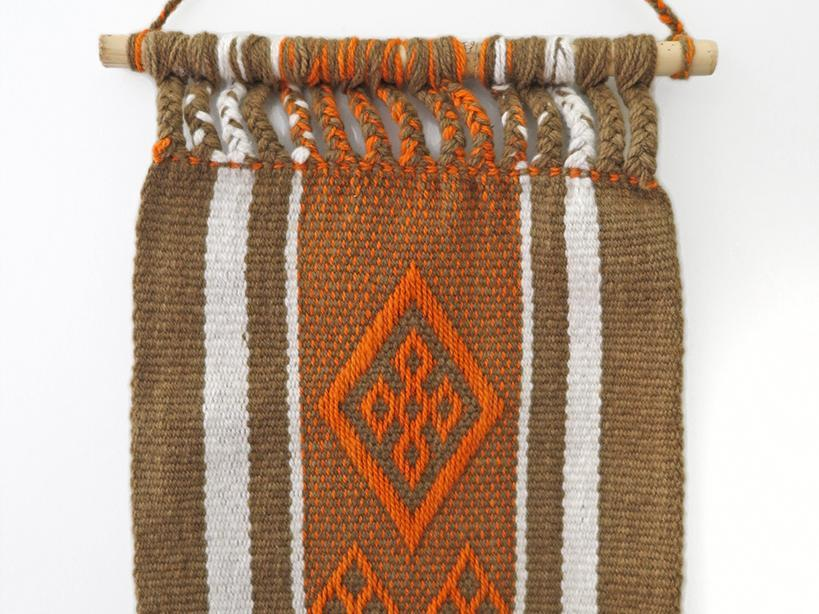
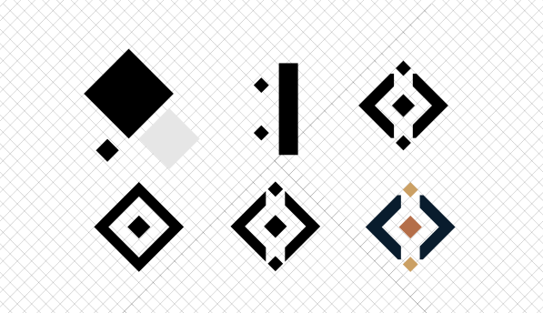
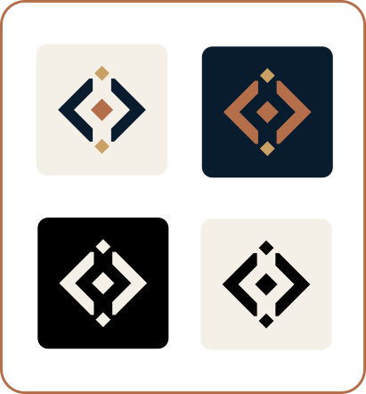

# KELLU — Isotype and identity history

This record distinguishes the actual sequence of design exploration from later geometric formalisation.

## 1. Visual references and cultural inspiration

The initial exploration considered geometric structures found in Mapuche textile traditions. The goal was to investigate forms, symmetry, rhythm and modular composition as visual references for a new identity—not to reproduce a traditional symbol or claim a traditional meaning for KELLU.

### References to review

A. [Cuadro con diseño ñimin: cruz tetrádica — Ona Chile](https://onachile.com/en/products/cuadro-con-diseno-nimin-cruz-tetradica)

B. [Textil mapuche — Chile Patrimonios](https://www.chilepatrimonios.gob.cl/ficha?doi=02SDC-3-24598)

C. [El arte textil en el Lavkenmapu de Nawelbuta — Museo Mapuche de Cañete](https://www.museomapuchecanete.gob.cl/galeria/el-arte-textil-en-el-lavkenmapu-de-nawelbuta)

These links are research starting points supplied for this design record. Verify the specific object, description, attribution and cultural context before making interpretive claims in public-facing material.

### A. Diamonds and symmetry

Rhomboid geometry offers a basis for a compact, centred and balanced symbol. In KELLU, this can be interpreted contemporarily as a visual nucleus for assistance or coordination. That is a design interpretation, not a translation of a traditional textile motif.

### B. Lines and geometric paths

Greca-like or stepped paths can inspire an original visual language for a request moving between agents. Any association with AI orchestration is a contemporary design metaphor, not a claim about the cultural meaning of the reference motif.

### C. Repetition and modular composition

Repeated geometric units can inspire a visual system extensible to KELLU and future agents in the KATE ecosystem. Shared geometry can create family resemblance while allowing each agent to have its own distinguishing treatment. This is a proposed design-system application, not a statement about the meaning of Mapuche textiles.

## 2. Initial playful concept

ChatGPT produced a playful prototype during concept exploration, condensing the emerging visual idea into a logo-like composition. This stage should be presented as an exploratory proposal, not the final vector master.

## 3. Geometric formalisation in Inkscape

The project owner reconstructed and systematised the concept in Inkscape using rotated squares, diagonal construction lines, support lines and Boolean difference operations. These define the outer frame, central diamond, terminal diamonds and two angular side elements.

See [isotype-construction.md](isotype-construction.md).

## 4. Final isotype and colour variants

Show the final isotype in colour on deep navy (`#091C2D`), in colour on a light background, in monochrome black on a light background, and in monochrome white on a dark background. The exported SVGs should have transparent backgrounds; backgrounds shown in the presentation are examples of use, not part of the logo.

## 5. Wordmark development

The wordmark is based on Fraunces 72pt Soft, then modified to harmonise with the isotype. Details are in [typography.md](typography.md).
Fraunces
## 6. Terminal identity mockup

The terminal mockup demonstrates the identity in a text-only interface. It is a prototype/presentation asset, not necessarily production CLI output.

## 7. Contribution notes

- **Exploratory visual prototype:** developed with ChatGPT during collaborative concept exploration.
- **Geometric reconstruction and Inkscape formalisation:** performed by the project owner.
- **Final production assets:** identify these by the actual SVG/PNG files committed to the repository.

The process record intentionally does not claim that every proportion was mathematically specified in the first sketch.
